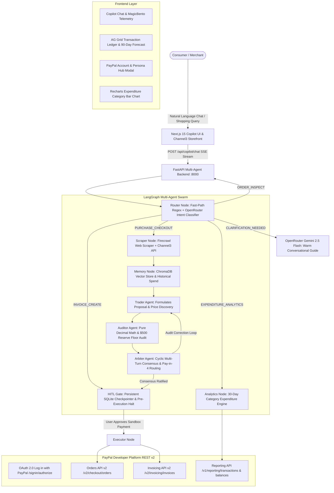

# Can I Buy It? — Guardian AI Copilot for PayPal

[](LICENSE)
[](https://www.python.org/)
[](https://nextjs.org/)
[](https://fastapi.tiangolo.com/)
[](https://developer.paypal.com/)
[](https://openrouter.ai/)
[](https://github.com/confident-ai/deepeval)

> **Submitted to the PayPal AI Hackathon: Build What's Next with PayPal and AI**  
> **Repository:** [https://github.com/SnippyCodes/Can-I-Buy-It-.git](https://github.com/SnippyCodes/Can-I-Buy-It-.git)  
> **Target Awards:** Grand Prize, Best Use of Agentic Commerce, Best Use of AG Grid, and Best Use of Channel3.

---

## 🌟 The Problem: The Overdraft Hazard of Agentic Commerce
Autonomous shopping agents and AI checkout bots are increasingly authorized to transact on behalf of consumers and businesses. However, standard checkout bots operate blindly: they see an item in a cart, check if the current balance is sufficient for that single purchase, and execute the payment.

They have **zero situational awareness** of the buyer's upcoming real-world liabilities—such as rent due in three days, payroll obligations, tuition, or recurring utility bills. An agent that blindly executes a $300 purchase because the account has $350 will trigger overdraft fees or leave the user unable to pay rent.

---

## 🛡️ The Solution: "Can I Buy It?" Guardian AI Copilot
**"Can I Buy It?" (Guardian Copilot)** is an autonomous agentic commerce copilot designed specifically for the PayPal ecosystem. It introduces:
1. **Sacred $500.00 Protected Liquidity Reserve Floor:** The agent mathematically models rolling cash flow against upcoming obligations and strictly refuses to approve any discretionary purchase that would breach the $500 floor.
2. **Autonomous Multi-Agent Consensus Swarm:** A stateful LangGraph swarm composed of specialized agents (Router, Scraper, Memory, Trader, Auditor, Arbiter) that rigorously debates every transaction before generating any checkout order.
3. **Intelligent PayPal Pay Later (Pay in 4) Routing:** When a single upfront lump-sum payment is risky, the copilot automatically calculates bi-weekly Pay in 4 installments ($87.50 down vs. $350.00 upfront) and verifies if the installment schedule safely preserves liquidity.
4. **Human-in-the-Loop (HITL) Pre-Execution Authorization:** The copilot never charges a card or debits PayPal autonomously. It stages orders in a pre-execution gate requiring explicit user authorization.
5. **Universal Multi-Merchant Discovery:** Search 100M+ products across 25,000+ stores using text or image search powered by **Channel3**.
6. **Live Multi-Tenant PayPal Sandbox Suite:** Official "Log in with PayPal" OAuth 2.0 flow, real-time transaction reporting, and a 10-persona bulk sandbox account suite (`sandbox-bulk-accounts.csv`).

---

## 🏗️ System Architecture



---

## 💳 How PayPal is Used in This Project

This project integrates directly with the **PayPal Developer REST API v2** ecosystem across multiple official endpoints:

### 1. PayPal Orders API (`/v2/checkout/orders`)
- **Order Creation with Pay Later:** When a retail purchase passes multi-agent consensus, the agent calls `POST https://api-m.sandbox.paypal.com/v2/checkout/orders` with `intent: "CAPTURE"`, structured items, currency, and tax.
- **Idempotency Enforcement:** Every PayPal order dispatch includes a cryptographically secure `PayPal-Request-Id: <UUIDv4>` header, preventing duplicate transactions under retry or network fluctuation.
- **Capture Execution:** Following explicit user authorization in the HITL gate, the backend executes `POST /v2/checkout/orders/{id}/capture` to complete payment.

### 2. PayPal Pay in 4 (Buy Now, Pay Later) Dynamic Routing
- When a user's cash reserves cannot absorb an upfront purchase without dropping below the $500 safety floor, the copilot dynamically computes the **PayPal Pay in 4** schedule (4 bi-weekly payments with 0% APR).
- Example: Purchasing a $350 item with a $600 balance drops the account to $250 (Breaching the $500 floor). The agent autonomously routes to PayPal Pay in 4, charging $87.50 down and preserving $512.50 in liquid reserves.

### 3. PayPal Invoicing API (`/v2/invoicing/invoices`)
- Supports freelancers, contractors, and businesses receiving incoming payments.
- Calls `POST /v2/invoicing/generate-next-invoice-number`, constructs invoice details (recipient email, line items, payment terms, currency), and stages the draft.
- Dispatches the invoice via `POST /v2/invoicing/invoices/{id}/send`.

### 4. PayPal Real-Time Reporting API (`/v1/reporting/transactions` & `/v1/reporting/balances`)
- Queries real transactions from the user's PayPal Sandbox account over the past 30 days (`GET /v1/reporting/transactions?fields=all`).
- **Dual Live API + Write-Through Merging:** Merges live PayPal reporting with local SQLite write-through capture orders (deduplicated by `paypal_id`) to eliminate PayPal's 3-hour reporting index lag during live demonstrations.

### 5. "Log in with PayPal" (OAuth 2.0 Authorization Code Flow)
- Uses PayPal's official hosted consent screen (`GET https://www.sandbox.paypal.com/signin/authorize`).
- Exchanges authorization code for personal access/refresh tokens (`POST /v1/oauth2/token`).
- Fetches user identity (`GET /v1/identity/oauth2/userinfo?schema=paypalv1.1`), creating a multi-tenant user account in SQLite.

### 6. Pre-Configured Bulk Sandbox Account Suite (`sandbox-bulk-accounts.csv`)
- Fully compliant with PayPal Developer's **"Bulk Sandbox Account Creation"** format (`sandbox-bulk-headers.csv`).
- Provides 10 provisioned test personas (password: **`Guardian2026!`**) representing:
  - **Michael Buyer (Healthy):** $3,500.00 Balance (Safe discretionary spend).
  - **Emma Savings (Tight Reserve):** $550.00 Balance (Triggers Pay-in-4 on spend > $50).
  - **James Student (Overdraft Risk):** $200.00 Balance (Declines discretionary spend < $500 floor).
  - **Alex Merchant (Verified Vendor):** $10,000.00 Balance (Receives customer payments).
  - **Sarah Procurement (Enterprise Client):** $5,000.00 Balance (Receives PayPal invoices).

---

## 🤖 How AI is Used in This Project

### 1. LangGraph Multi-Agent Consensus Swarm
Rather than relying on a single prompt or monolithic LLM, Guardian Copilot employs a stateful multi-agent swarm built with **LangGraph**:
- **Router Agent:** High-speed regex fast-path (0ms) coupled with OpenRouter structured intent extraction. Directs queries to the proper agent pipeline.
- **Scraper Agent:** Autonomous web scraping via **Firecrawl** and catalog lookups via **Channel3** to extract authentic live prices, merchant reputation, and product metadata.
- **Memory Node:** Stores and retrieves user transaction history and recurring obligations via **ChromaDB** vector embeddings.
- **Trader Agent (Proposal Agent):** Formulates the transaction proposal, verifies product pricing against benchmark catalogs, and recalculates line items.
- **Auditor Agent (Math & Invariant Verifier):** Enforces pure Python `Decimal` arithmetic (`item_total + tax == stated_total`) and validates that `current_balance - total >= $500.00`. If math fails or the floor is breached, it raises explicit audit flags.
- **Arbiter Agent (Debate Coordinator):** Manages a cyclic debate loop (up to 2 revision turns) between Trader and Auditor. If consensus is ratified, it structures the HITL action card. If paying upfront is unsafe, it synthesizes a PayPal Pay-in-4 recommendation.
- **Analytics Engine:** Aggregates transactions, categorizes expenses (`Cloud & APIs`, `Housing & Rent`, `Hardware`, `Software & SaaS`, `Retail`), and generates visual horizontal bar chart data.

### 2. Conversational Guidance Engine (OpenRouter + Gemini 2.5 Flash)
- Powered by **OpenRouter** using `google/gemini-2.5-flash`.
- Provides empathetic, human-like financial guidance. When a user chats casually (*"Hey, can you help me buy a keyboard?"*), Guardian responds warmly, explains their current liquid balance and discretionary budget, and guides them step-by-step without requiring rigid keywords or command-line syntax.
- Bounded token windows (`max_tokens: 300 - 500`) prevent runaway inference costs while maintaining high-speed interactive streaming.

### 3. Automated Agent Safety Evaluation (DeepEval + OpenEval)
- Integrated with **[DeepEval](https://github.com/confident-ai/deepeval)** and **OpenEval** (using OpenRouter LLM-as-a-Judge) to audit the agent on every build:
  - **ToolCorrectnessMetric & ArgumentCorrectnessMetric:** Verifies that purchase queries invoke `create_order` with exact parameters, and invoice queries invoke `create_draft_invoice`.
  - **TaskCompletionMetric:** Verifies full task execution without human abandonment.
  - **GEval Anti-Hallucination Metric:** Ensures non-existent orders return `NOT_FOUND` without fabricating merchant names or dollar amounts.
  - **Deterministic Invariant Assertion:** Proves that discretionary purchases breaching the $500 reserve floor are blocked 100% of the time.
- **Status:** **5/5 Tests Passed** (`pytest backend/tests/evals/test_guardian_evals.py`).

---

## 🛠️ Other Tools & Sponsor Integrations

| Technology / Sponsor | Purpose in Project |
| :--- | :--- |
| **Channel3 API** | Universal multi-merchant product catalog search across 25,000+ stores and 100M+ products. Powers text search, image search, variant resolution, and automated affiliate commission link tracking (`.agents/skills/channel3-api`). |
| **Firecrawl API** | High-performance e-commerce web scraper extracting dynamic prices, inventory status, and merchant credentials from live checkout URLs. |
| **AG Grid & AG Charts** | High-density dark-mode financial transaction ledger with custom currency formatters, dynamic status renderers, and interactive 90-day cash flow projection curves. |
| **ChromaDB** | Semantic vector database providing long-term episodic memory for past expenditures and recurring liabilities. |
| **APIMatic & Postman** | Complete PayPal REST v2 API specification validation, automated OpenAPI client generation, and Postman collection testing. |
| **SQLite with Custom Checkpointer** | Zero-dependency, crash-resilient session persistence via `PersistentSqliteCheckpointer` in LangGraph, ensuring active HITL payment authorizations survive process restarts. |
| **Next.js 15 & React 19** | Modern App Router frontend featuring Server-Sent Events (SSE) streaming, MagicBento telemetry cards, and dark-mode Tailwind CSS styling. |
| **FastAPI & Python 3.12** | Asynchronous Python backend coordinating the LangGraph state machine, PayPal REST v2 client, and SQLite database. |
| **Render / Vercel** | Containerized deployment target for the FastAPI backend and Next.js frontend. |

---

## 🚀 Quickstart & Local Setup Instructions

### Prerequisites
- **Node.js:** v18.17+ or v20+
- **Python:** v3.11 or v3.12
- **Git**
- A free **PayPal Developer Account** ([developer.paypal.com](https://developer.paypal.com/))

---

### Step 1: Clone the Repository
```bash
git clone https://github.com/SnippyCodes/Can-I-Buy-It-.git
cd Can-I-Buy-It-
```

---

### Step 2: Configure Environment Variables
Create a `.env` file in the project root:
```env
# PayPal Sandbox Credentials (from developer.paypal.com -> Apps & Credentials)
PAYPAL_MODE=sandbox
PAYPAL_CLIENT_ID=your_paypal_sandbox_client_id
PAYPAL_CLIENT_SECRET=your_paypal_sandbox_client_secret
PAYPAL_API_BASE_URL=https://api-m.sandbox.paypal.com
PAYPAL_SANDBOX_EMAIL=your_sandbox_merchant@business.example.com

# Financial Safety Settings
DEFAULT_MINIMUM_SAFETY_BALANCE=500.00
DEFAULT_CURRENCY=USD
SIMULATION_HORIZON_DAYS=90

# OpenRouter / Gemini API Key (For Conversational Copilot & OpenEval)
OPENROUTER_API_KEY=your_openrouter_api_key

# Channel3 Product Discovery API Key
CHANNEL3_API_KEY=your_channel3_api_key

# Firecrawl Web Scraping API Key
FIRECRAWL_API_KEY=your_firecrawl_api_key
```

---

### Step 3: Set Up & Run the Python Backend (FastAPI + LangGraph)
In your terminal:
```bash
# 1. Create and activate a Python virtual environment
python -m venv venv

# Windows:
venv\Scripts\activate
# macOS/Linux:
# source venv/bin/activate

# 2. Install dependencies
pip install -r requirements.txt

# 3. Start the FastAPI backend server
uvicorn backend.app.main:app --reload --host 0.0.0.0 --port 8000
```
> The backend will start on **`http://localhost:8000`**.  
> Interactive OpenAPI documentation is available at **`http://localhost:8000/docs`**.

---

### Step 4: Set Up & Run the Frontend (Next.js 15)
In a new terminal window:
```bash
# 1. Install frontend dependencies
npm install

# 2. Start the Next.js development server
npm run dev
```
> The frontend application will be live at **`http://localhost:3000`**.  
> Navigate to **`http://localhost:3000/copilot`** to launch the Guardian Copilot chat interface.

---

### Step 5: (Optional) Bulk Create Sandbox Accounts in PayPal
To simulate all 10 financial scenarios in your PayPal Sandbox environment:
1. Log in to [developer.paypal.com](https://developer.paypal.com/).
2. Navigate to **Testing Tools** $\to$ **Sandbox Accounts**.
3. Click **Create Account** $\to$ **Bulk Sandbox Account Creation**.
4. Drag and drop the included [`sandbox-bulk-accounts.csv`](sandbox-bulk-accounts.csv) file from the repo.
5. Click **Create Accounts**.
6. All accounts are created with password **`Guardian2026!`**.
7. In the Copilot UI, click your profile in the sidebar to open the **PayPal Account & Persona Hub** and switch between personas instantly!

---

### Step 6: Run Automated Agent Safety Evaluations
To verify all financial safety invariants and multi-agent consensus pipelines:
```bash
venv\Scripts\pytest backend/tests/evals/test_guardian_evals.py -v
```
**Expected Output:**
```text
backend/tests/evals/test_guardian_evals.py::test_case_1_invoice_intent_isolation PASSED [ 20%]
backend/tests/evals/test_guardian_evals.py::test_case_2_non_existent_order_anti_hallucination PASSED [ 40%]
backend/tests/evals/test_guardian_evals.py::test_case_3_outgoing_purchase_safety_floor_math_audit PASSED [ 60%]
backend/tests/evals/test_guardian_evals.py::test_case_4_valid_outgoing_purchase_consensus PASSED [ 80%]
backend/tests/evals/test_guardian_evals.py::test_expenditure_graph_no_checkout_hallucination PASSED [100%]
============================= 5 passed in 31.94s ==============================
```

---

## 📁 Repository Directory Layout

```text
├── app/                           # Next.js 15 App Router
│   ├── api/copilot/chat/          # Streaming reverse proxy forwarding to FastAPI
│   ├── api/actions/               # Human-in-the-Loop decision actions
│   ├── copilot/page.tsx           # Main Guardian Copilot dark-mode interface
│   └── page.tsx                   # Channel3 Storefront & Search UI
├── backend/                       # Python 3.12 Backend Architecture
│   ├── app/
│   │   ├── agent/                 # LangGraph Multi-Agent Architecture
│   │   │   ├── graph.py           # Swarm compilation & conditional branch routing
│   │   │   ├── checkpoint.py      # SQLite persistent state checkpointer
│   │   │   ├── state.py           # Typed AgentState schema
│   │   │   └── nodes/             # Swarm Agent Nodes
│   │   │       ├── router.py      # Intent router (Regex + OpenRouter Gemini 2.5)
│   │   │       ├── clarification.py# Warm conversational guidance engine
│   │   │       ├── trader_node.py # Proposal generation & price discovery
│   │   │       ├── auditor_node.py# Decimal math & $500 floor verification
│   │   │       ├── arbiter_node.py# Cyclic consensus debate & Pay-in-4 routing
│   │   │       ├── analytics_node.py# 30-day category expenditure engine
│   │   │       ├── hitl_gate.py   # Pre-execution authorization gate
│   │   │       ├── executor.py    # Real PayPal REST v2 execution
│   │   │       ├── scraper.py     # Firecrawl & Channel3 catalog scraper
│   │   │       └── memory_node.py # ChromaDB vector memory ledger
│   │   ├── api/routes/            # FastAPI Endpoints
│   │   │   ├── copilot.py         # SSE streaming chat endpoint
│   │   │   ├── auth.py            # PayPal OAuth2 & persona hub endpoints
│   │   │   └── actions.py         # HITL approval/rejection endpoints
│   │   ├── core/                  # Database & config
│   │   │   ├── database.py        # SQLite multi-tenant ledger & personas
│   │   │   └── config.py          # Pydantic enterprise settings
│   └── tests/evals/               # DeepEval & OpenEval Benchmark Suite
│       └── test_guardian_evals.py # 5 comprehensive safety test cases
├── components/copilot/            # UI Component Kit
│   ├── sidebar.tsx                # Collapsible sidebar with active persona card
│   ├── modals.tsx                 # PayPal Account Hub & Bulk CSV modal
│   ├── message-stream.tsx         # SSE streaming message feed
│   ├── action-cards.tsx           # HITL payment authorization cards
│   ├── ExpenditureChartCard.tsx   # Category-wise bar chart component
│   └── bento-analytics.tsx        # MagicBento telemetry widgets
├── sandbox-bulk-accounts.csv      # Ready-to-upload PayPal Bulk Sandbox Accounts
├── requirements.txt               # Python package dependencies
├── package.json                   # Node.js dependencies
├── LICENSE                        # Approved OSI MIT License
└── README.md                      # Comprehensive project documentation
```

---

## 📄 License
This project is open-source and licensed under the [MIT License](LICENSE), an approved Open Source Initiative (OSI) license.
